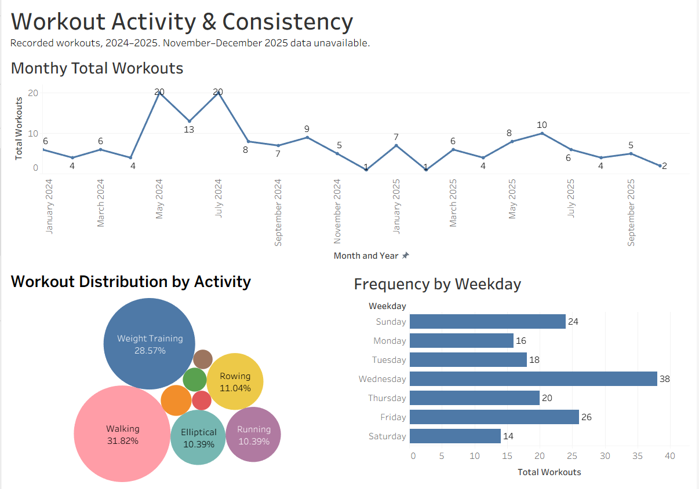
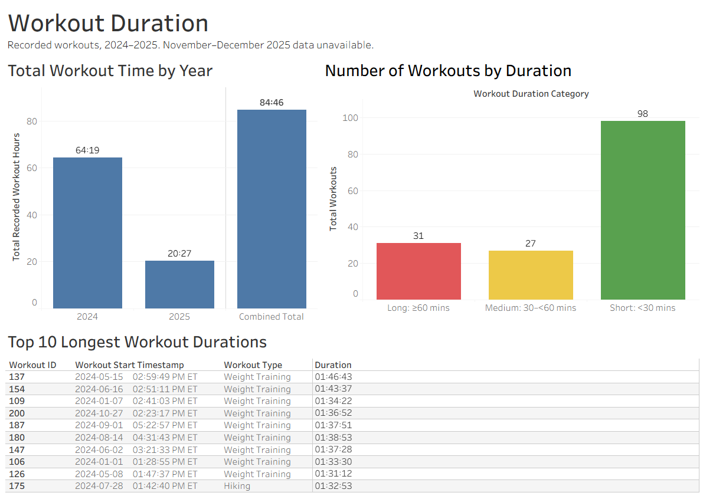
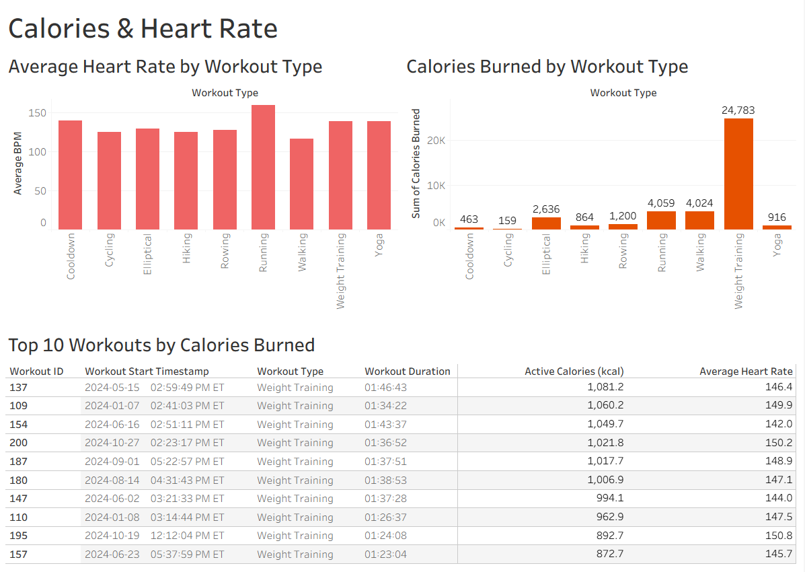

# Apple Fitness Workout Analysis

## Project Overview

I created this project to explore my Apple Fitness workout records from 2024–2025 while practicing data cleaning, SQL, and dashboard design.

I wanted to better understand my workout habits, including which activities I recorded most often, how long my workouts lasted, and how my activity changed over time. I used Excel Power Query to prepare the data, SQL Server to analyze it, and Tableau to present the results.

## Project Files

### SQL Scripts
These scripts create the database tables, load the cleaned data,
and analyze the workouts.

- [Create tables](sql/01_Create_Tables.sql)
- [Load data](sql/02_Load_Tables.sql)
- [Analyze workouts](sql/03_Analysis_Queries.sql)

### Power Query
These files contain the steps used to clean and prepare
the Apple Fitness data in Excel.

- [Workout cleaning code](power-query-m/workouts-cleaning.txt)
- [Workout statistics cleaning code](power-query-m/workout-statistics-cleaning.txt)

## Tools Used

| Tool | How I used it |
|---|---|
| Excel Power Query | Imported and cleaned the Apple Health export |
| SQL Server | Stored the cleaned data and queried workout records |
| Tableau | Created charts and dashboards |
| GitHub | Organized and shared my code and project documentation |

## Data Preparation

I started with an XML export from Apple Health and used Power Query to prepare the workout records and their related measurements.

My preparation included:

- Selecting the fields needed for the analysis.
- Renaming columns and making workout names easier to read.
- Setting data types for dates, durations, and measurements.
- Organizing workout details and statistics into separate tables.
- Using Workout ID to connect workouts to their statistics.
- Reviewing missing values and invalid records.

I kept missing measurements separate from zero values. For charts based on dates, I excluded entries that could not be assigned to a valid date.

After cleaning the data, I imported it into SQL Server for analysis.

## Analysis Questions

I focused on these questions:

- Which workout types did I perform most often, and what percentage did each represent?
- How much recorded workout time did I have each year?
- Which weekdays did I work out most often?
- How many workouts were short, medium, or long?
- How many workouts did I record each month?
- Which workouts lasted the longest?
- How did recorded active calories and average heart rate differ by workout type?
- Which workouts had the highest recorded active calories?

## Dashboards

### Workout Activity & Consistency

This dashboard shows monthly workout totals, workout frequency by weekday, and the distribution of workouts by activity.

### Workout Duration

This dashboard shows recorded workout time by year, the number of workouts in each duration category, and the ten longest workouts.

The duration categories are:

| Category | Workout length |
|---|---|
| Short | Under 30 minutes |
| Medium | 30 to under 60 minutes |
| Long | 60 minutes or longer |

### Calories & Heart Rate

This dashboard compares recorded active calories and average heart rate across workout types. It also includes the ten workouts with the highest recorded active calories.

## Findings

*I will add my main findings here after checking the final SQL results against the Tableau dashboards.*

## Limitations

- November and December 2025 data is unavailable, so the annual totals do not represent two complete years.
- Missing measurements are not treated as zero. Calorie and heart-rate summaries use the available measurements.
- These results describe my recorded workouts, which may not capture all of my physical activity.
- This project uses my personal data and is not intended to represent other people's workout habits.

## Project Files

| Folder | Contents |
|---|---|
| `sql` | Scripts for creating tables, loading data, and running the analysis |
| `power-query-m` | Power Query code used to prepare the data |
| `screenshots` | Images of the Tableau dashboards |
| `tableau-dashboard-screenshots` | Tableau workbook files |
| `data-clean` | Any cleaned data included for sharing |

## How to Reproduce the Analysis

You will need Excel with Power Query, SQL Server, SQL Server
Management Studio, and Tableau. Using your own Apple Health
export will produce different results from those shown here.

### 1. Export your Apple Health data

1. Open the Health app on your iPhone.
2. Tap your profile picture or initials in the upper-right corner.
3. Scroll down and tap Export All Health Data.
4. Confirm the export and wait for it to finish.
5. Save the ZIP file to a private location you can access from
   your PC, such as your own iCloud Drive or OneDrive.
6. Download the ZIP file to your PC.
7. Right-click the ZIP file and select Extract All.
8. Open the extracted folders and locate export.xml, usually
   inside the apple_health_export folder.

The complete export contains personal health information.
Keep it private and do not upload it to a public GitHub repository.

### 2. Prepare the data in Excel Power Query

1. Open Excel and create a blank Power Query.
2. Open the Advanced Editor.
3. Use the cleaning code in the power-query-m folder.
4. Update the source file path to point to your own export.xml file.
5. Create the queries in dependency order: the workout query
   before any lookup or statistics queries that reference it.
6. Keep query names consistent with the references in the code.
7. Review the date and activity filters. This project analyzes
   selected workout types from 2024 and 2025.
8. Refresh the queries and check the resulting tables.
9. Load the cleaned workout and statistics tables into Excel
   and save the workbook.

Check that each workout has a unique Workout ID and that its
related statistics use the same ID. Review missing values and
confirm that dates, durations, and measurements have the
appropriate data types.

### 3. Create the SQL Server database

1. Open SQL Server Management Studio and connect to your server.
2. Open sql/01_Create_Tables.sql.
3. Run the script once to create the AppleFitness database,
   dbo.Workouts, and dbo.WorkoutStatistics.

If these objects already exist, inspect them before proceeding
instead of running the creation script again.

### 4. Import the cleaned data into staging tables

1. Export the two cleaned Excel tables to separate CSV files.
2. In SQL Server Management Studio, right-click AppleFitness
   and select Tasks > Import Flat File.
3. Import the workout CSV as dbo.Workouts_Staging.
4. Import the statistics CSV as dbo.WorkoutStatistics_Staging.
5. Review the detected column names, data types, and null settings
   before completing each import.

The staging column names must match those referenced in
02_Load_Tables.sql. Preserve missing measurements as NULL
rather than replacing them with zero.

### 5. Load the final tables

1. Open sql/02_Load_Tables.sql.
2. Run the entire script in the same query window.
3. Compare the staging and final row counts shown in the results.

This script is intended for an initial load into empty final
tables. It stops if either final table already contains data.

### 6. Run the analysis

1. Open sql/03_Analysis_Queries.sql.
2. Run the entire script from the beginning so its temporary
   tables are available to the later queries.
3. Review the results for workout frequency, duration,
   monthly activity, calories, and heart rate.

### 7. Review the Tableau dashboards

1. Open the workbook in the tableau folder, if included.
2. Update its Excel connection to your cleaned workbook.
3. Confirm that workouts and statistics are related by Workout ID.
4. Refresh the data.
5. Apply the same date ranges and activity filters used in SQL.
6. Compare the dashboard values with the SQL results.

Dashboard images are available in the tableau-dashboard-screenshots folder.

### Data limitations

The original project has no available workout records for
November and December 2025. These months are treated as missing
data, not confirmed months with zero workouts.

Missing measurements are not replaced with zero. Entries
without valid dates are excluded from date-based analysis.

